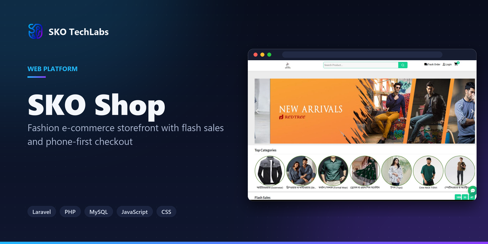
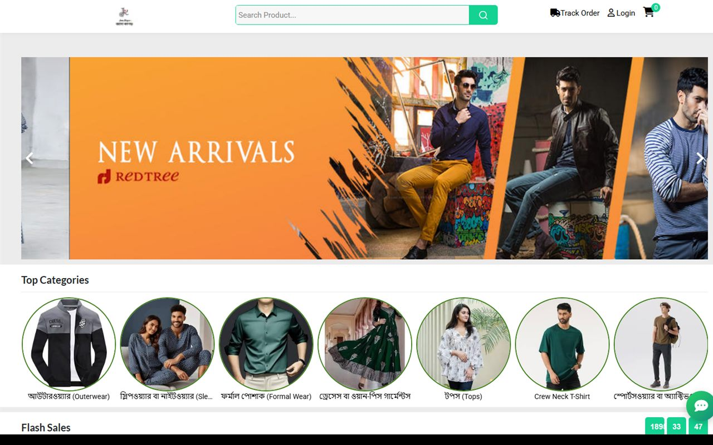

<h3>Fashion e-commerce storefront with flash sales and phone-first checkout</h3>

Clothing storefront with a deep category tree, countdown-driven flash sales, cart and checkout, and a layout built for phone-first shoppers.

   

<a href="https://ecommerce5.skotechlabs.com"><b>Live Demo</b></a> &nbsp;·&nbsp; <a href="https://skotechlabs.com/projects/sko-shop-fashion-ecommerce-storefront"><b>Case Study</b></a> &nbsp;·&nbsp; <a href="https://skotechlabs.com/contact"><b>Request a Demo</b></a> &nbsp;·&nbsp; <a href="https://github.com/skotechlabs"><b>All Products</b></a>

---

## Overview

A fashion storefront covering the whole path from browsing to order tracking. Categories run several levels deep across menswear and womenswear, and the home page is driven by campaigns - flash sales and hot deals on live countdown timers rather than hand-edited banners.

Almost all traffic for a shop like this arrives on a phone, so the mobile layout carries its own bottom navigation and a chat button that never leaves the screen.

<table>
<tr>
<td width="50%" valign="top">

### The Challenge

A clothing catalogue is never a flat list. Sizes, categories and weekly campaigns all move, and a storefront built as static pages is out of date the day after it launches.

</td>
<td width="50%" valign="top">

### Our Solution

Everything the shopper sees is driven by catalogue and campaign data. Category rails, flash sales and hot deals are records rather than hand-edited markup, so the front page changes without anyone touching the site.

</td>
</tr>
</table>

## Key Features

- Multi-level clothing category tree
- Flash sale and hot deal campaigns with countdowns
- Product detail with pricing, discount and stock
- Cart, checkout and order tracking
- Search across the catalogue
- Mobile bottom navigation and floating chat
- Bangla interface with taka pricing
- Admin control over products, categories and campaigns

## Business Impact

- Flash sale and hot deal rails with live countdowns
- A category tree deep enough for a real clothing catalogue
- Phone-first layout with persistent bottom navigation
- Order tracking without needing an account

## Screenshots

<table>
<tr>
<td width="50%" valign="top"> SKO Shop: Fashion e-commerce storefront with flash sales and phone-first checkout</td>
<td width="50%"></td>
</tr>
</table>

> See it running: **[ecommerce5.skotechlabs.com](https://ecommerce5.skotechlabs.com)**

## Technology Stack

## Source Code & Licensing

This repository is the public showcase for **SKO Shop**. The production source code is proprietary and is maintained privately by SKO TechLabs.

Interested in this product for your business? We offer:

- **Ready-to-launch deployment** of SKO Shop under your own brand and domain
- **Customisation** of features, workflows, languages and integrations to fit how you work
- **Custom development** of a new product built on the same foundations
- **Ongoing support**, hosting, maintenance and feature roll-outs after launch

## Get in Touch

---

© 2026 <a href="https://skotechlabs.com">SKO TechLabs</a> · Dhaka, Bangladesh · Building intelligent digital solutions

